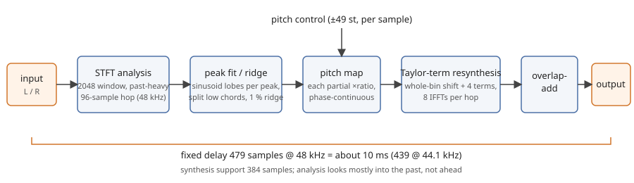
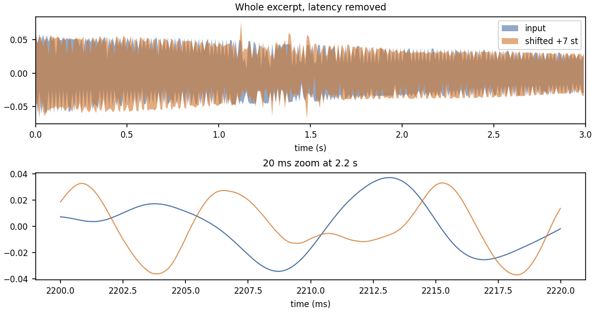
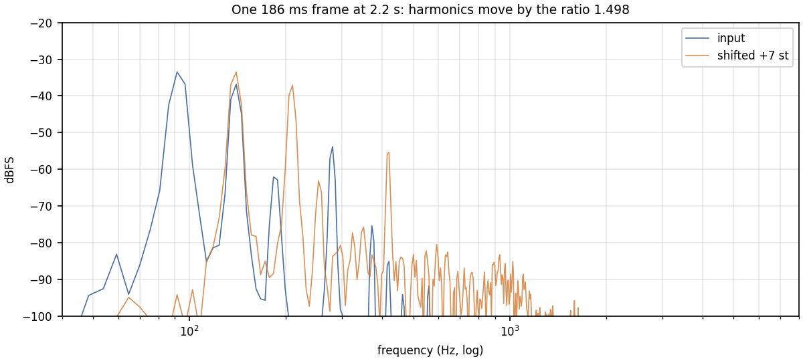
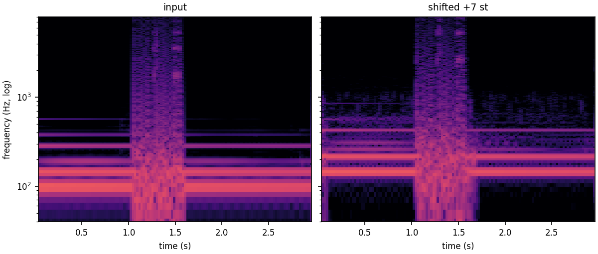

# Pitchwing

A reusable C++ guitar pitch-shifting engine. Low-register polyphonic quality
and 8–10 ms added DSP latency are co-primary goals. VST/plugin development is
outside this project.

`LiveEngine` provides linked stereo, live fractional pitch controls through ±49
semitones, arbitrary blocks, and about 10 ms fixed DSP delay. It follows the
separate ShiftKey project's control and buffer requirements. The original mono,
static `Engine` remains a reference port of the accepted Python experiment,
with an explicit deterministic startup policy. New output needs listening
against the preserved originals. Known DC and unresolved low-dyad defects remain;
these engines are not yet validated production replacements. See
[project scope](PROJECT.md), [development record](DEVELOPMENT.md), and
[measured DSP limitations](experiments/transport/FINDINGS.md).

See [live validation](docs/live-validation.md) and
[ShiftKey integration](docs/shiftkey-integration.md) for the consumer API and
checks. [Original native validation](docs/native-validation-results.md) retains
the static engine's listening render, parity, and timing evidence.

## How it works



Pitchwing is an STFT sinusoidal-peak transport shifter, not a time-stretch /
resample or delay-line design. A low guitar chord packs several partials into
a few FFT bins, and an 8–10 ms budget rules out the long windows that would
separate them, so the engine models the partials explicitly and moves them:

1. **STFT analysis**: a 2048-sample, past-heavy window every 96 samples at
   48 kHz, with peaks picked on the shared L/R magnitude so both channels
   follow the same partials.
2. **Peak fit / amplitude ridge**: each peak is fitted as a sinusoid lobe of
   the analysis window (including its mirror-image term, which keeps the
   estimate stable below bin 4). Below 700 Hz a longer, decimated analysis
   splits unresolved low-chord partials into components whose amplitudes are
   solved jointly with a 1 % ridge, bounding the cancelling amplitudes that real
   strums otherwise produce.
3. **Pitch map**: every partial or residual region is translated by
   `(ratio − 1)·f` with a phase-continuous rotation integrated from the
   per-sample pitch control, so no extra smoothing is applied to the control.
4. **Shared Taylor-term resynthesis**: each translation becomes a whole-bin
   circular shift plus a four-term Taylor remainder (≤ −73 dB), so all entries
   add into four spectra per channel and a hop costs 8 inverse FFTs instead of
   one per region. This is what made real-time playback possible.
5. **Overlap-add** of a 384-sample synthesis support. Declared delay is fixed:
   439 / 479 / 959 samples at 44.1 / 48 / 96 kHz, about 10 ms.

Known defects, in one line: DC and image residue, close low dyads that shift
rigidly when unresolved, warble on dense split groups, and 96 kHz small-block
callback misses. The maths and measurements are in
[the live engine design](docs/live-engine.md) ("Linked stereo analysis",
including "Amplitude ridge" and "Shared synthesis") and
[the native core](docs/native-core.md).

`stems/chord.wav` 14–17 s (a sustained low chord, 44.1 kHz) shifted +7
semitones through `pitchwing_live_render`, regenerated by
`scripts/readme_figures.py`:





## Build

Requires a C++17 compiler and CMake 3.20 or newer. The small MIT-licensed FFT
dependency is bundled; the build downloads nothing. In this WSL workspace,
keep generated files on the Linux filesystem:

```sh
export PATH="/tmp/pitchwing-env/bin:$PATH"  # Approved temporary CMake installation.
cmake -S . -B /tmp/pitchwing-build -DCMAKE_BUILD_TYPE=Release
cmake --build /tmp/pitchwing-build --parallel 2
ctest --test-dir /tmp/pitchwing-build --output-on-failure
```

If a tool is missing, obtain approval before installing it. See
[native validation](docs/native-validation.md) for the offline comparison runner
and [native core](docs/native-core.md) for the processing contract. For macOS
on Apple Silicon see [the untested build guide](docs/apple-silicon.md).

## Use

```cpp
#include <pitchwing/LiveEngine.hpp>

pitchwing::LiveEngine engine({44100.0, -7.0}); // Prepare outside the callback.

// Both channels contain frameCount samples. Output planes must be separate.
auto status = engine.setPitchSemitones(-5.25); // Audio thread, without resetting.
if (status == pitchwing::Status::Ok)
    status = engine.process(inputLeft, inputRight, outputLeft, outputRight, frameCount);
// Check status. Float/double, in-place, and duplicated mono input are supported.
```

Link `pitchwing::pitchwing` through `add_subdirectory` or installed
`find_package(pitchwing CONFIG REQUIRED)`. Tools/tests default off when embedded;
no packages are downloaded. Query `latencySamples()` for audio/dry alignment:
439 at 44.1 kHz, 479 at 48 kHz, 959 at 96 kHz. Pitch response timing is a separate
measurement. Prepare storage before processing; processing, pitch setters,
reset, and flush allocate nothing. Instances require one caller at a time.
For offline output, allocate two planes of `tailSamples()` and call `flush()`
once; it closes the stream until reset. Reset discards history and is not a live
bypass operation. See [the full live contract](docs/live-engine.md).

The numerical reference is in `experiments/transport/`. Corpus descriptions,
render recipes, and the user's preferred `06/minus7` attack example are in
[the corpus guide](experiments/corpus/README.md). Imported research and its
measurements remain unchanged in `research/`.

## Project structure

| Directory | Purpose |
|---|---|
| `src/` | `Engine` (static mono reference port) and `LiveEngine` (linked stereo, live pitch control). |
| `include/pitchwing/` | Public headers; the only installed files. |
| `tests/` | Contract tests run by `ctest` (`pitchwing_engine`, `pitchwing_live_engine`). |
| `tools/` | Offline renderers and the timing / step-response probe. |
| `scripts/` | Python quality gates, fixtures, native comparison, and the README figures. |
| `experiments/` | Python transport reference, quality studies, and the corpus guide. |
| `research/` | Imported research checkpoint and measurements; never modified. |
| `docs/` | Design, validation, quality notes, saved results, and figures. |
| `third_party/` | Bundled Signalsmith Linear FFT (MIT). |
| `cmake/` | Package config template for `find_package(pitchwing)`. |

`stems/` holds the user's guitar recordings; it is local and git-ignored
(see [the corpus guide](experiments/corpus/README.md)).

## License

GPL-3.0; see [LICENSE](LICENSE). The bundled `signalsmith-linear` FFT is MIT
licensed ([third_party/README.md](third_party/README.md)).
